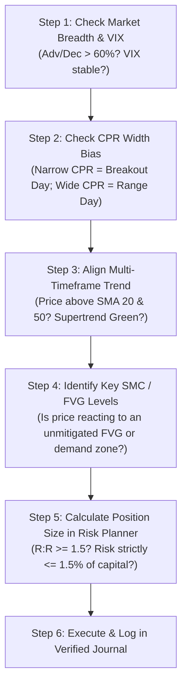

# Trading Intelligence Pro — Complete User Handbook & Operational Guide

Welcome to **Trading Intelligence Pro**, an institutional-grade financial analysis terminal designed specifically for Indian Equity and Derivatives Markets (**NSE Equities, NIFTY 50, BANK NIFTY, Index & Stock F&O**).

This guide walks you step-by-step through every feature, indicator, pattern rule, risk calculator, and analysis screen so you can make disciplined, data-driven trading decisions.

---

## Table of Contents
1. [Quick Start: How to Open the Platform](#1-quick-start-how-to-open-the-platform)
2. [Top Status Bar & Market Breadth](#2-top-status-bar--market-breadth)
3. [Workspace Navigation & Layout](#3-workspace-navigation--layout)
4. [Mastering the Interactive Charting Engine](#4-mastering-the-interactive-charting-engine)
5. [Technical Indicators Explained](#5-technical-indicators-explained)
6. [Central Pivot Range (CPR) Master Strategy](#6-central-pivot-range-cpr-master-strategy)
7. [Smart Money Concepts (SMC) & Pattern Recognition](#7-smart-money-concepts-smc--pattern-recognition)
8. [Trade Risk Planner & Position Sizing Calculator](#8-trade-risk-planner--position-sizing-calculator)
9. [Indian Statutory Charges & Taxes Breakdown](#9-indian-statutory-charges--taxes-breakdown)
10. [Verified Trading Journal & Performance Attribution](#10-verified-trading-journal--performance-attribution)
11. [Options Chain & Greeks Analyzer](#11-options-chain--greeks-analyzer)
12. [Strategy Builder & Zero-Bias Backtesting Lab](#12-strategy-builder--zero-bias-backtesting-lab)
13. [Pro Trader Checklist & Daily Routine](#13-pro-trader-checklist--daily-routine)

---

## 1. Quick Start: How to Open the Platform

The entire platform is self-contained and ready to run immediately in your web browser with zero setup:

### Method A: Direct Double-Click
- Navigate to your project folder: `d:\AntiGravity\AntiGravity Work`
- Double-click **`Trading_Intelligence_Pro.html`**
- It opens instantly in your default web browser (Google Chrome, Microsoft Edge, Brave, etc.).

### Method B: Windows Launcher
- Double-click **`START_TRADING_INTELLIGENCE_PRO.bat`**
- This automatically opens the platform in your browser.

> **Privacy & Offline Notice:** All your journal entries, watchlists, and risk preferences are stored securely in your browser's private local storage (`localStorage`). No private data leaves your computer.

---

## 2. Top Status Bar & Market Breadth

Located at the very top of the screen, this bar provides a real-time macro overview of the Indian market:

1. **Market Session Badge**:
   - Shows `NSE • LIVE FEED` during market hours (09:15 AM to 03:30 PM IST on weekdays).
   - Shows `MARKET CLOSED (EOD)` after hours and on weekends.
2. **Market Breadth (Advance / Decline Bar)**:
   - Shows how many NSE stocks are advancing vs declining across the market.
   - **Green Bar Dominance (> 60% Adv)**: Strong broad market demand. High probability for LONG trend-following setups.
   - **Red Bar Dominance (> 60% Dec)**: Broad market selling pressure. High probability for SHORT setups or defensive hedging.
3. **Indices Ticker Strip**:
   - **NIFTY 50 (^NSEI)**: Benchmark Indian Equity index.
   - **BANK NIFTY (^NSEBANK)**: High-beta banking index (HDFC Bank, ICICI Bank, SBI, Kotak).
   - **NIFTY IT (^CNXIT)**: IT services index (TCS, Infosys, Wipro).
   - **INDIA VIX (^INDIAVIX)**: Market Volatility Index. A rising VIX indicates increasing fear and larger price swings; a falling VIX indicates steady, confident trending markets.
4. **Live Clock**: Displays real-time Indian Standard Time (IST).

---

## 3. Workspace Navigation & Layout

Use the left sidebar icons to switch between views:

| Sidebar Button | Tool Name | Description |
| :--- | :--- | :--- |
| <i class="ri-bar-chart-2-fill"></i> **Terminal** | **Main Trading Terminal** | Unified 3-column workspace with Watchlist, Interactive Chart, Analysis Drawer, and Risk Planner. |
| <i class="ri-scan-2-line"></i> **SMC Scanner** | **Multi-Asset Scanner** | Real-time matrix of top NSE stocks with Trend classification, RSI, CPR, and active candle patterns. |
| <i class="ri-shield-check-line"></i> **Risk Planner** | **Capital & Risk Manager** | Configure account capital, daily loss limits, and maximum risk budgets per trade. |
| <i class="ri-book-read-line"></i> **Trade Journal** | **Performance Tracker** | Log executed trades and review verified Win Rate %, Net Realized P&L, Profit Factor, and Drawdowns. |
| <i class="ri-stack-line"></i> **Options Chain** | **Options & Greeks** | Strike-by-strike Call/Put prices, Open Interest, Delta, Implied Volatility (IV), and Put-Call Ratio (PCR). |
| <i class="ri-cpu-line"></i> **Backtest Lab** | **Strategy Simulator** | Formulate rules and backtest them across historical bars with statutory fee deductions. |

---

## 4. Mastering the Interactive Charting Engine

The central chart is built on a high-performance HTML5 Canvas engine designed for responsive, latency-free financial charting.

### Chart Controls Toolbar:
- **Symbol Badge**: Displays the currently active stock or index (e.g., `RELIANCE.NS`, `NIFTY 50`).
- **Timeframe Selector**:
  - `1M` / `5M`: Fast scalp trading and immediate order flow execution.
  - `15M`: Recommended default for intraday swing setups and SMC structure breaks.
  - `1H` / `1D`: Positional and swing trend identification.
  - `1W`: Macro multi-month structure and major institutional support/resistance.
- **Chart Styles**:
  - **CANDLE**: Standard Japanese candlesticks (Green = Bullish close $\ge$ open; Red = Bearish close $<$ open).
  - **HEIKIN (HA)**: Smooths out market noise to highlight strong trends.
  - **AREA**: Clean visual area chart showing closing price momentum.
- **Zoom & Pan Controls**:
  - Click **Zoom In (+)** to expand individual candle wicks.
  - Click **Zoom Out (-)** to see broader multi-month market context.
  - Click **Reset (<i class="ri-refresh-line"></i>)** to restore default 65-bar perspective.
- **Crosshair Inspection**:
  - Move your mouse over any candle to see the precise vertical and horizontal alignment lines.
  - The right axis highlights the exact price at your cursor.
  - The bottom axis displays the exact date of the bar.
  - The top HUD banner updates in real time showing:
    - **O (Open)**, **H (High)**, **L (Low)**, **C (Close)**, **Vol (Volume)**, and **Change %**.

---

## 5. Technical Indicators Explained

Toggle indicators on or off via the checkboxes on the chart toolbar:

### A. Simple Moving Averages (SMA 20 & SMA 50)
- **SMA 20 (Cyan Line)**: 20-period average price. In a healthy uptrend, price stays above SMA 20.
- **SMA 50 (Amber Line)**: Intermediate trend filter.
- **The Golden Rule**: When price is above both SMA 20 and SMA 50, and SMA 20 is sloping upwards above SMA 50, look strictly for LONG buying setups. Avoid counter-trend shorting.

### B. Supertrend (10, Multiplier 3.0)
- **Green Line below Price**: Market is in a confirmed Bullish Trend. The green line serves as trailing dynamic support.
- **Red Line above Price**: Market is in a confirmed Bearish Trend. The red line serves as dynamic overhead resistance.
- **Trend Reversal Signal**: When a candle closes on the opposite side of the Supertrend line, the band flips color, signaling an institutional trend change.

### C. Relative Strength Index (RSI 14)
- Displayed in the bottom Analysis drawer.
- **Above 70 (Overbought)**: Market is stretched. Look for confirmation before entering new long positions; consider taking partial profits.
- **Below 30 (Oversold)**: Selling pressure is exhausted. Look for bullish reversal pinbars/hammers.
- **40 - 60 Range**: Healthy trend continuation zone.

---

## 6. Central Pivot Range (CPR) Master Strategy

The **Central Pivot Range (CPR)** is one of the most powerful price-action frameworks used by Indian professional intraday traders.

### Components of CPR:
1. **Central Pivot (P)** = $\frac{\text{High} + \text{Low} + \text{Close}}{3}$
2. **Bottom Central (BC)** = $\frac{\text{High} + \text{Low}}{2}$
3. **Top Central (TC)** = $(\text{Pivot} - \text{BC}) + \text{Pivot}$
4. **Key Resistance 1 (R1)** = $(2 \times \text{Pivot}) - \text{Low}$
5. **Key Support 1 (S1)** = $(2 \times \text{Pivot}) - \text{High}$

### How to Trade with CPR:
- **CPR Width Bias**:
  - **Narrow CPR (< 0.25% width)**: Indicates consolidation in the previous session. Expect a **strong directional trending breakout day**. Target moves toward R1 and R2.
  - **Wide CPR (> 0.40% width)**: Indicates a large move already took place yesterday. Expect a **range-bound, sideways day**. Avoid breakout chasing; buy near S1 and sell near R1.
- **Price Above TC**: Bullish bias for the day. Look for pullbacks to TC to buy.
- **Price Below BC**: Bearish bias for the day. Look for bounces to BC to short.

---

## 7. Smart Money Concepts (SMC) & Pattern Recognition

The platform features an automated, rule-based pattern engine that enforces mathematical criteria:

### A. Fair Value Gaps (FVG)
- A **Fair Value Gap** is a 3-candle price imbalance created by aggressive institutional buying or selling.
- **Bullish FVG (Green Highlight Box)**: Created when Candle 3's Low is strictly higher than Candle 1's High, leaving an unfilled price void. Institutional algorithms often return to test this zone before resuming upward momentum.
- **Bearish FVG (Red Highlight Box)**: Created when Candle 3's High is strictly lower than Candle 1's Low.
- **Status Tracking**:
  - **UNMITIGATED**: Price has not yet retested this zone. High-probability entry area.
  - **MITIGATED**: Price has already revisited and filled the imbalance.

### B. High-Conviction Candlestick Formations
- **Bullish Engulfing**: A large green candle whose real body completely swallows the prior red candle's body. Signals that buyers have overwhelmed sellers.
  - *Confirmation Rule*: Next candle closes above the high of the engulfing bar.
  - *Invalidation Rule*: Price closes below the low of the engulfing candle.
- **Hammer (Pinbar)**: Small body at the top of the candle with a lower shadow at least $2\times$ the body length. Shows strong rejection of lower prices.
- **Shooting Star**: Small body at the bottom with a long upper wick. Shows rejection of higher prices at resistance.

---

## 8. Trade Risk Planner & Position Sizing Calculator

The Trade Risk Planner (located in the right column of the Terminal) ensures you never over-leverage your account.

### How to Size Your Trade:
1. **Choose Direction**: Click `LONG` (buying) or `SHORT` (selling).
2. **Enter Account Capital**: e.g., ₹5,00,000.
3. **Set Risk Per Trade (%)**: Professional traders risk between **1.0% and 1.5%** of capital per trade. Never risk more than 2%.
4. **Enter Entry, Stop Loss, and Target Prices**:
   - The planner immediately calculates:
     - **Exact Position Size (Quantity & Lots)**: Automatically calculated so that if your Stop Loss is hit, you lose *only* your budgeted risk amount.
     - **Reward-to-Risk (R:R) Ratio**: Must be at least **1.5 : 1** (indicated in Green). If R:R is below 1.5, the tool warns you that the trade is mathematically unfavorable.
     - **Capital at Risk (₹)**: Monetary risk amount.

### Example Walkthrough:
- **Capital**: ₹5,00,000
- **Risk %**: 1.0% = Maximum allowable loss is **₹5,000**
- **Stock**: RELIANCE at ₹1,200
- **Stop Loss**: ₹1,180 (Risk per share = ₹20)
- **Target**: ₹1,250 (Reward per share = ₹50)
- **Calculation**:
  $$\text{Quantity} = \frac{₹5,000}{₹20} = 250 \text{ shares}$$
  $$\text{Reward-to-Risk} = \frac{₹50}{₹20} = 2.5 : 1 \text{ (Favorable)}$$

Click **"Save Trade to Journal"** to instantly log this planned setup into your verified trade journal!

---

## 9. Indian Statutory Charges & Taxes Breakdown

Trading Intelligence Pro automatically computes the realistic statutory charges for Indian market trades so you know your true net profitability:

| Charge Item | Rate / Regulatory Formula | Who Receives It |
| :--- | :--- | :--- |
| **Brokerage** | Flat ₹20 per executed order (or 0.03%, whichever is lower) | Broker (Zerodha, Angel One, Groww, etc.) |
| **STT / CTT** | 0.025% on sell side (Equity Intraday) / 0.1% (Delivery) | Government of India (Tax) |
| **Exchange Turnover** | 0.00325% on total trade turnover | National Stock Exchange (NSE) |
| **SEBI Turnover Fee** | ₹10 per crore (0.0001%) | SEBI (Regulator) |
| **Stamp Duty** | 0.003% on buy side (Intraday) | State Government |
| **GST** | 18% on (Brokerage + Exchange fees + SEBI fees) | Central & State Government |

- **Breakeven Per Share**: The minimum number of points the stock must move in your favor just to cover all transaction costs and taxes.

---

## 10. Verified Trading Journal & Performance Attribution

Access this module via the **Trade Journal** button in the sidebar.

### Core Metrics Tracked:
1. **Win Rate (%)**: Percentage of winning trades:
   $$\text{Win Rate} = \left(\frac{\text{Winning Trades}}{\text{Total Trades}}\right) \times 100$$
2. **Net Realized P&L (₹)**: Cumulative profit or loss after deducting all statutory charges and brokerage.
3. **Profit Factor**: Ratio of gross profits to gross losses:
   $$\text{Profit Factor} = \frac{\text{Gross Winning Sum}}{\text{Gross Losing Sum}}$$
   - Above 1.8: Good performance.
   - Above 2.2: Institutional-grade edge.
4. **Maximum Drawdown (₹)**: The largest dollar drop from an equity peak to a subsequent trough. Essential for tracking risk exposure.

### Logging a Trade:
- Click **"Log Completed Trade"**
- Enter the Symbol, Side (LONG/SHORT), Entry price, Exit price, Quantity, and Setup Type (e.g., *CPR Breakout*, *SMC Order Block*).
- Add notes on what went well or lessons learned.
- Click **"Save Trade"**. The performance metrics update immediately.

---

## 11. Options Chain & Greeks Analyzer

Access this module via the **Options Chain** button in the sidebar.

### Understanding the Option Chain:
- **Center Column (STRIKE)**: Strike prices for the underlying index or stock. The row closest to the current spot price is the **At-The-Money (ATM)** strike.
- **Left Columns (CALLS / CE)**:
  - **Open Interest (OI)**: Total active contracts held by market participants.
  - **Delta ($\Delta$)**: Sensitivity of option price to a ₹1 change in the underlying spot price. ATM call delta is $\approx 0.50$.
  - **Implied Volatility (IV)**: Expected future volatility priced into option premiums.
  - **LTP (₹)**: Last traded price of the call option.
- **Right Columns (PUTS / PE)**: Put option prices, delta, and open interest.

### Put-Call Ratio (PCR) Analysis:
- **PCR = Total Put Open Interest $\div$ Total Call Open Interest**
- **PCR > 1.2 (Bullish)**: Put writers (institutions selling downside insurance) outnumber call writers. Indicates strong floor support.
- **PCR < 0.8 (Bearish)**: Call writers dominate. Indicates heavy overhead supply resistance.
- **PCR 0.8 to 1.2 (Neutral)**: Balanced market conditions.

---

## 12. Strategy Builder & Zero-Bias Backtesting Lab

Access this module via the **Backtest Lab** button in the sidebar.

### How to Build & Simulate a Strategy:
1. **Formulate Rules**: Select logical rule combinations:
   - *Price closes above 50-period EMA*
   - *Supertrend (10, 3) flips Bullish*
   - *Wilder's RSI (14) > 52.0*
2. **Click "Run Zero-Bias Backtest"**:
   - The simulation engine steps through verified historical candles chronologically.
   - At each candle $t$, only information from $[0..t]$ is used. It **never peeks forward** to future bars ($t+1$).
   - Realistic slippage and statutory NSE fees are automatically deducted from each simulated trade.
3. **Review the Results**:
   - Total Net Return %
   - Win Rate %
   - Profit Factor
   - Maximum Drawdown %
   - Annualized Sharpe Ratio

---

## 13. Pro Trader Checklist & Daily Routine

Follow this 5-step routine before placing any trade:

1. **Step 1: Macro Check**: Look at the top status bar. Is market breadth advancing or declining? Is INDIA VIX calm?
2. **Step 2: CPR Width**: In the Analysis panel, check if CPR is Narrow (prepare for a trend day) or Wide (prepare to fade extremes).
3. **Step 3: Trend Alignment**: Ensure your trade direction matches the Supertrend and 50 EMA. Don't fight the institutional tide.
4. **Step 4: SMC Zones**: Look for price retesting an unmitigated Fair Value Gap (FVG) or clean candlestick confirmation pattern.
5. **Step 5: Strict Position Sizing**: Use the Risk Planner to calculate your exact quantity. Never guess your position size.
6. **Step 6: Log & Review**: After closing the trade, record it in your Trading Journal to maintain disciplined performance tracking.

---

## 8. AI Day Trader Copilot & Google Gemini Integration

The platform includes an autonomous AI Day Trader Copilot powered by the 11 modular Day Trader engines (from `Jakeschincariol/day-trader-skill`) and Google Gemini AI:

### A. Dual Market Support (NSE India 🇮🇳 & US Markets 🇺🇸)
- Toggle between **NSE (India)** and **US (NASDAQ / NYSE)** in the top navigation bar.
- Currency indicators (`₹` for NSE, `$` for US), tickers, charts, and position sizing adapt automatically.
- Covers Indian equities (`NIFTY 50`, `BANK NIFTY`, `RELIANCE`, `TCS`, `HDFCBANK`) and US mega-caps (`NVDA`, `TSLA`, `AAPL`, `MSFT`, `AMZN`, `SPY`, `QQQ`).

### B. Google Gemini 2.5 AI Key Configuration
- Click **`Gemini AI`** in the top navigation bar to open the API Key modal.
- Enter your free API Key from [Google AI Studio](https://aistudio.google.com/app/apikey).
- Click **⚡ Test Connection** to verify live connection.
- Keys are saved locally in browser storage (`localStorage`) with zero external transmission.

### C. 1-Click Human-in-the-Loop Approval Workflow
1. Navigate to the **🤖 AI Day Trader** tab in the sidebar.
2. Click **Scan Markets** to detect Opening Range Breakouts (ORB), 20-Day Highs, Bull Flags, and Oversold Bounces.
3. Select any candidate setup and click **Analyze with Gemini**.
4. The AI Dossier displays:
   - **Institutional Conviction Meter** (e.g., 88% Conviction).
   - **Institutional Thesis & Catalysts**.
   - **Time Machine Simulation** (10,000 Monte Carlo replays: Target Hit % vs Stop Hit % and expected R-multiple).
   - **Order Bracket Ticket** (Entry, Stop Loss, Take Profit, Sized Shares, Max Risk).
5. Click **`✓ 1-Click Approve Trade (Paper)`** to execute the trade safely into your Trading Journal with a unique execution Ticket ID.

---

*Trading Intelligence Pro — Built for disciplined, institutional-grade execution.*
